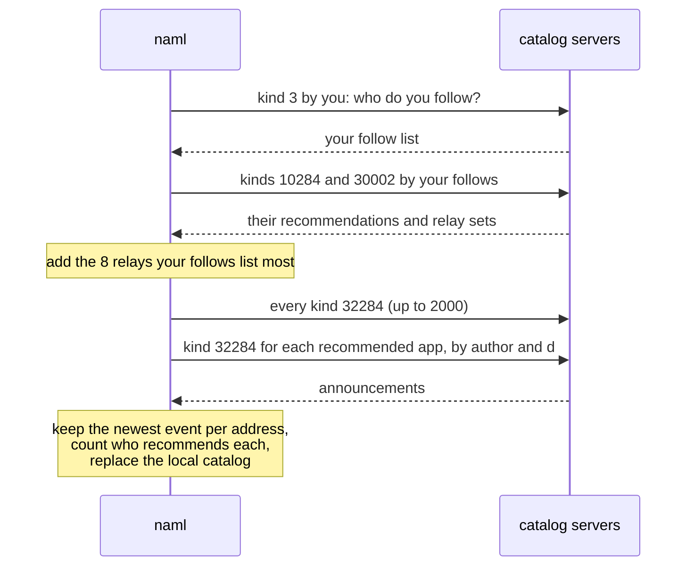

+++
title = "The catalog protocol"
description = "The nostr events behind naml's catalog: app announcements, recommendations and relay sets."
weight = 70

[extra]
lead = "The catalog is made of signed nostr events. Anyone can publish them with naml or any other nostr tool."
+++

## App announcements: kind 32284

An app is one addressable event of kind `32284`. Its address is
`32284:<pubkey>:<d>`: the publisher's key and the app's id. Publishing a new
event with the same `d` replaces the old one, and that is how updates are
announced.

| tag | required | meaning |
|---|---|---|
| `d` | yes | the app's id, unique among the publisher's apps |
| `url` | yes, repeatable | where to download the file; extra ones are mirrors |
| `x` | yes | the file's sha256, lowercase hex |
| `name` | | display name |
| `summary` | | one line about the app |
| `version` | | its version |
| `icon` | | an image url |
| `web` | | homepage |
| `license` | | license |
| `t` | repeatable | categories or keywords |
| `arch` | repeatable | supported architectures: `x86_64`, `aarch64`, … (none means any) |
| `format` | | `appimage`, `binary`, `tar.gz`, `tar.xz`, `tar.zst`, `tar.bz2`, `tar` or `zip` (sniffed from the file when missing) |
| `exec` | | for archives, the path of the executable inside it |
| `update` | | AppImageUpdate update information, for delta updates |
| `size` | | file size in bytes |

The content is a free-form description.

```json
{
  "kind": 32284,
  "tags": [
    ["d", "my-app"],
    ["url", "https://github.com/me/app/releases/download/v1.2.0/App-x86_64.AppImage"],
    ["x", "4f1c…e9"],
    ["name", "My App"],
    ["summary", "does things"],
    ["version", "1.2.0"],
    ["arch", "x86_64"],
    ["format", "appimage"],
    ["update", "gh-releases-zsync|me|app|latest|App-*x86_64.AppImage.zsync"],
    ["t", "Utility"]
  ],
  "content": "A longer description."
}
```

## Recommendations: kind 10284

A user's recommended apps are a replaceable list of kind `10284`, with one
`a` tag per app, in the NIP-51 style:

```json
{ "kind": 10284, "tags": [["a", "32284:<pubkey>:my-app"], ["a", "32284:<pubkey>:other"]] }
```

## Catalog servers: kind 30002, d=naml

The relays a user uses for naml are a NIP-51 relay set (kind `30002`) with
`d` set to `naml` and one `relay` tag per relay.

## How sync uses them



Without a [login](@/docs/guide/catalog.md#your-identity), only the
announcements are fetched. Updates, and installs given as `<author>/<id>`,
skip the local catalog and ask the catalog servers directly for the newest
announcement, by author and `d`.

Signing uses a secret key or a NIP-46 remote signer (`bunker://`). In CI, the
`NAML_SECRET_KEY` environment variable provides the key without storing it.
