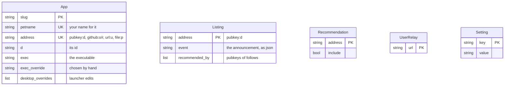

+++
title = "The database"
description = "What naml stores, and how its schema evolves."
weight = 60

[extra]
lead = "naml keeps its state in a single redb file, through orangedb: typed tables, unique indexes and automatic migrations."
+++

## Tables



### App

One row per installed app. Besides the fields above:

| field | meaning |
|---|---|
| `pubkey` | the publisher, for catalog apps |
| `name`, `summary`, `version` | how it is shown |
| `format`, `source_url`, `sha256`, `size` | the installed file |
| `root` | the app's directory |
| `icon_url`, `icon_file` | where its icon came from, and where it is |
| `desktop_file`, `desktop_wanted`, `integrate` | its launcher, whether you asked for one, and whether it may have one at all (`--no-desktop`) |
| `bin_link` | its command |
| `update_info` | AppImageUpdate information |
| `event`, `event_created_at` | the catalog announcement it was installed from |
| `http_validator` | the url's `ETag` or `Last-Modified` |
| `previous_sha256`, `previous_version`, `previous_exec` | the version a rollback goes back to |
| `locked` | whether updates skip it |
| `installed_at`, `updated_at` | timestamps |

### Listing

The local copy of the catalog: the newest announcement of each app, as the
signed event, and which of the people you follow recommend it. `naml sync`
replaces the whole table, so apps that vanished from the catalog servers go
away.

### Recommendation, UserRelay, Setting

Your manual changes to the recommendations list, the catalog servers you
added, and settings: your identity (`pubkey`, and `secret` or `bunker` with
its client key) and the time of the last sync.

## Migrations

orangedb computes a fingerprint of every table's layout at compile time.
When a newer naml opens a database written by an older one, it migrates the
changed tables row by row, in one transaction, before doing anything else.
An older naml can't open a newer database.

## Inspecting it

The database is locked while naml runs. Between runs, the `orangedb`
command-line tool can read it, since the file records its own schema:

```sh
cargo install orangedb-cli
orangedb ~/.local/share/naml/naml.redb            # tables and row counts
orangedb ~/.local/share/naml/naml.redb dump App   # every installed app
orangedb ~/.local/share/naml/naml.redb history    # every schema it went through
```
