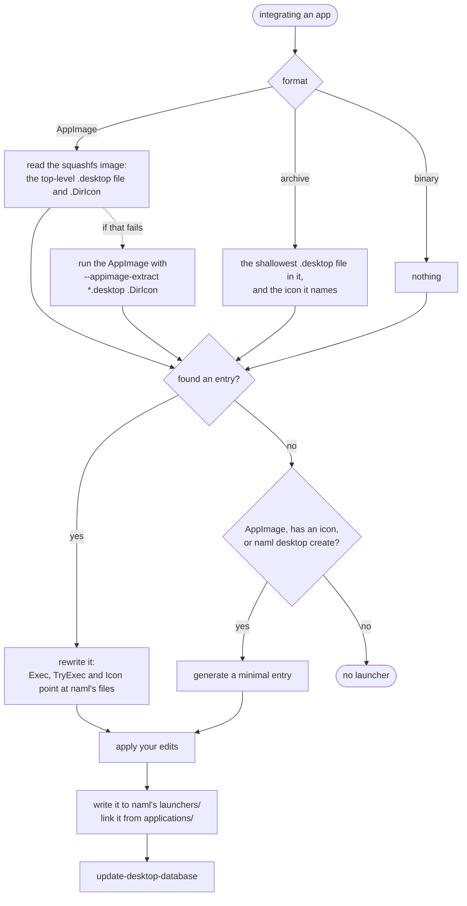

+++
title = "Launchers and icons"
description = "How naml builds desktop entries, finds icons and keeps your launcher edits."
weight = 50

[extra]
lead = "naml follows the freedesktop Desktop Entry Specification: each app gets a `.desktop` file and an icon, rebuilt whenever the app changes."
+++

## Where the entry comes from



**Rewriting.** In every group of the shipped entry (the main one and the
actions), `Exec=` keeps its arguments and field codes but its program becomes
the installed executable, quoted when needed. `TryExec=` points at the
executable and `Icon=` at the icon naml saved. An `X-Naml-Slug=<slug>` key is
added to the main group, so naml's launchers can be recognized.

**The minimal entry** is:

```ini
[Desktop Entry]
Type=Application
Name=<the app's name>
Exec=<the executable>
Terminal=false
Categories=Utility;
Comment=<its summary, if known>
Icon=<its icon, if any>
X-Naml-Slug=<slug>
```

**Other information.** The entry also fills in what naml doesn't know yet: the
app's display name (`Name`), summary (`Comment`) and version
(`X-AppImage-Version`).

## Icons

The icon is the AppImage's `.DirIcon`, or for archives the file named by the
entry's `Icon=` key (an SVG first, then the largest PNG, then an XPM). If the
app has none and its catalog announcement gives an icon url, naml downloads
that (up to 4 MiB). It is saved as `icons/<slug>.png`, `.svg` or `.xpm`,
depending on its contents.

## Names and links

Launchers are named `naml-<author>-<slug>.desktop`, for example
`naml-telegram.org-telegram.desktop` or `naml-github.com-lgse-strata.desktop`.
Every character other than letters, digits, `.`, `-` and `_` becomes `-`, so
the name is a valid desktop file id. The author part tells where the app came
from, and the slug keeps it unique.

The file itself lives in naml's `launchers/` directory. The applications
directory only holds a symlink to it, so everything naml owns stays in one
place.

## Your edits

[Launcher edits](@/docs/guide/customizing.md#launchers) are stored as a list
of changes to the `[Desktop Entry]` group (`Name=Telegram Desktop`,
`-Comment`). Each time the launcher is rebuilt, the steps above run again and
the changes are applied last, in order: a key is replaced where it is, or
added at the end of the group (before the next group); `-Key` removes it.
