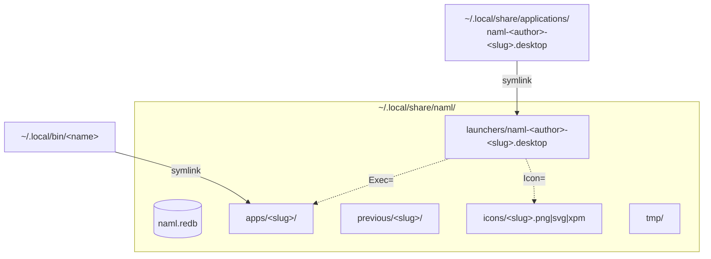

+++
title = "Files and directories"
description = "Every file naml reads or writes, for your apps and for apps installed for everyone."
weight = 40

[extra]
lead = "naml keeps to a few directories. Nothing outside them is changed, except the menu database refresh."
+++

## The layout

## Your apps

| path | what | written when |
|---|---|---|
| `~/.local/share/naml/naml.redb` | the [database](@/docs/internals/database.md): installed apps, the catalog, your identity and settings | every command |
| `~/.local/share/naml/apps/<slug>/` | the app: `<slug>.AppImage`, `<slug>` (a binary) or an extracted archive | install, update, rollback |
| `~/.local/share/naml/previous/<slug>/` | the version before the last update | update, rollback |
| `~/.local/share/naml/icons/<slug>.<ext>` | the app's icon | install, update, any change to the launcher |
| `~/.local/share/naml/launchers/naml-<author>-<slug>.desktop` | the app's desktop entry | same |
| `~/.local/share/applications/naml-<author>-<slug>.desktop` | a symlink to the desktop entry, where menus look for it | same |
| `~/.local/bin/<name>` | a symlink to the app's executable | install, rename, `set exec` |
| `~/.local/share/naml/tmp/` | scratch directories, removed when each command ends | downloads |
| `~/.config/systemd/user/naml-update.{service,timer}` | the [automatic updates](@/docs/guide/updating.md#automatic-updates) | `naml autoupdate enable` |

`<name>` is the app's name if you gave it one, otherwise its slug. In the
launcher's file name, the author is made of safe characters only:
`github.com/owner` becomes `github.com-owner`.

`~/.local/share` and `~/.config` follow `$XDG_DATA_HOME` and
`$XDG_CONFIG_HOME`, and `~/.local/bin` follows `$XDG_BIN_HOME`.

## Apps for everyone

With [`--system`](@/docs/guide/system-wide.md), the same layout lives in
system locations:

| path | what |
|---|---|
| `/var/lib/naml/naml.redb` | the database |
| `/opt/naml/apps/<slug>/` | the apps |
| `/opt/naml/previous/<slug>/` | previous versions |
| `/opt/naml/icons/`, `/opt/naml/launchers/` | icons and desktop entries |
| `/opt/naml/tmp/` | scratch space, next to the apps so they can be renamed into place |
| `/usr/local/bin/<name>` | commands |
| `/usr/local/share/applications/naml-<author>-<slug>.desktop` | menu entries |
| `/etc/systemd/system/naml-update.{service,timer}` | automatic updates |

## Outside naml's directories

After a launcher changes, naml runs `update-desktop-database` on the
applications directory, if that tool is installed, so desktop environments
notice. That refreshes the `mimeinfo.cache` there.

Nothing else is touched. In particular, naml never edits shell profiles: put
`~/.local/bin` on your `PATH` yourself if your distribution doesn't.

## What removing an app removes

Its directory under `apps/`, its previous version, its icon, its desktop
entry and the link to it, and its command. naml only removes a command or a
menu entry if it is one of naml's own links, pointing into naml's
directories.
