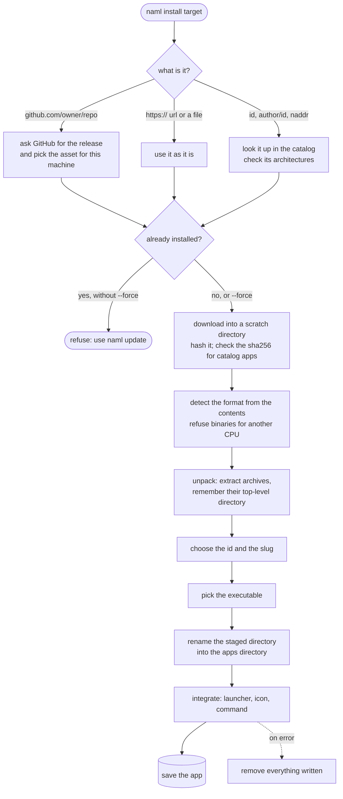
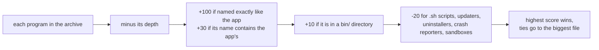

+++
title = "How installation works"
description = "Step by step through naml install: resolving, downloading, unpacking, picking the executable and integrating."
weight = 20

[extra]
lead = "What happens between `naml install <target>` and a working app in your menu."
+++

## The whole flow

## Resolving the target

The target is tried as, in order:

1. a **GitHub repository** url (`github.com/<owner>/<repo>`, optionally with
   `/releases/tag/<tag>`); direct release downloads are urls, not
   repositories;
2. an **http(s) url**, a `file://` url, or a path to an **existing file**;
3. otherwise a **catalog reference**: an `naddr`, `<author>/<id>`, or a bare
   id.

An app is already installed when its *address* is: `<pubkey>:<id>` for
catalog apps, `github:<owner>/<repo>`, `url:<url>` or `file:<path>`. With
`--force`, the old installation is removed first and its
[hand edits](@/docs/guide/customizing.md) are carried over.

For GitHub, the [asset rules](@/docs/guide/installing-apps.md#from-a-github-repository)
decide which file is downloaded.

## Downloading

The file goes into a fresh scratch directory under naml's `tmp/`, which is on
the same filesystem as the apps, so it can later be renamed into place. The
sha256 is computed while downloading. For catalog apps, each mirror url is
tried in turn until one gives the published hash. The server's `ETag` or
`Last-Modified` is remembered, to notice later when a url's file changes.

## Detecting the format

naml looks at the first bytes of the file, not its name:

| magic | format |
|---|---|
| `\x7fELF` with `AI` at offset 8 | AppImage |
| other `\x7fELF` | static binary |
| `1f 8b` | tar.gz |
| `fd 37 7a 58 5a 00` | tar.xz |
| `28 b5 2f fd` | tar.zst |
| `BZh` | tar.bz2 |
| `PK\x03\x04` | zip |
| `ustar` at offset 257 | tar |

AppImages and binaries whose ELF header names another CPU are refused.

## Unpacking

Single files (AppImages and binaries) are moved into the staging directory
as they are. Archives are extracted there, keeping file permissions and
refusing entries that would land outside it. When an archive holds a single
top-level directory (`Telegram/`, `helix-25.01-x86_64-linux/`), its contents
are moved up one level and the directory's name is remembered.

## Choosing the id and the slug

Catalog apps have their publisher's id. GitHub apps take the repository
name, unless you pass `--id`. For urls and files without `--id`, naml looks
for a meaningful name, in order:

1. the archive's top-level directory, unless it is a generic one like `bin`,
   `dist` or `release`;
2. if the url said nothing (`…/download/linux`), the file name the server
   gave, after redirects or from `Content-Disposition`;
3. the last part of the url or the file name.

Names are cleaned up the same way each time: lowercased, cut at the first
part that looks like a version or an architecture, so
`Obsidian-1.5.3-x86_64.AppImage` becomes `obsidian` and
`helix-25.01-x86_64-linux` becomes `helix`. If nothing is left, the id is
`app`.

The **slug**, which names the app's files, is your `--name` if you gave one,
otherwise the id, made unique with a suffix if needed: a short piece of the
publisher's npub for catalog apps, then `-2`, `-3`, …

## Picking the executable

AppImages are stored as `<slug>.AppImage`, binaries as `<slug>`, so their
paths don't change across updates. For archives, the executable is, in order
of preference:

1. the one you [chose by hand](@/docs/guide/customizing.md#choosing-the-executable)
   (on reinstalls and updates);
2. the publisher's `exec` path, for catalog apps;
3. the best-scoring program in the tree.

Every file that is executable and starts like a program (an ELF header or a
`#!` line) is scored:

The names it is compared with are the slug, the id, the app's display name
and the archive's top-level directory. Shared libraries (`.so`) are never
picked.

## Integrating

Once the files are in place, naml writes the
[launcher and icon](@/docs/internals/desktop-integration.md) and links the
command `~/.local/bin/<name>` to the executable. An existing file there that
isn't one of naml's own links is left alone, with a warning.

The app is saved in the [database](@/docs/internals/database.md) only after
everything worked. If anything fails, the launcher, icon, command and app
directory written so far are removed again.
