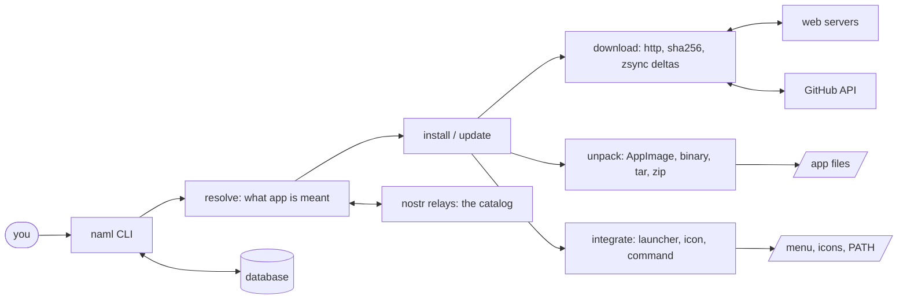

+++
title = "Overview"
description = "naml's parts and how they fit together."
weight = 10

[extra]
lead = "naml is one binary with a small database. It talks to three kinds of servers and writes to a handful of directories."
+++

## The big picture

- **Resolving** turns what you typed into an app: an installed app by name,
  id or `<author>/<id>`; a catalog app by id, `<author>/<id>` or `naddr`; a
  GitHub repository; a url; a local file.
- **Downloading** fetches files over https, hashing them on the way, and
  checks catalog files against their published sha256. AppImages with
  update information are updated with [zsync](@/docs/internals/updates.md#zsync-delta-updates)
  deltas.
- **Unpacking** lays the app out in a scratch directory and picks its
  executable; see [How installation works](@/docs/internals/installation-process.md).
- **Integrating** writes the [launcher](@/docs/internals/desktop-integration.md),
  the icon and the command.
- The **database** remembers every installed app and the catalog; see
  [The database](@/docs/internals/database.md).

## Principles

**No root, no daemon.** Your apps live in your home directory and naml only
runs when you call it (or when its [timer](@/docs/guide/updating.md#automatic-updates)
does). Apps for everyone are the only thing that needs root, and naml asks
for it only then.

**Never run what you install to learn about it.** AppImages are read
directly: the ELF header gives the offset of the squashfs image and the
update information, and the desktop entry and icon are read out of the
squashfs. Only if that fails does naml fall back to the AppImage's own
`--appimage-extract`.

**Swap, don't patch.** New versions are staged next to the installed one and
moved into place with a rename. The old version is renamed aside, which is
what makes [rollbacks](@/docs/guide/updating.md#rolling-back) instant.

**Remember intent, not results.** Your changes (a chosen executable, launcher
edits, a name) are stored as such and re-applied every time naml rebuilds an
app's integration, so updates don't undo them.

**Clean up everything.** Each file naml creates is recorded, and removing an
app removes all of it. A failed install leaves nothing behind.

## Where things are

| | |
|---|---|
| [Files and directories](@/docs/internals/files.md) | every path naml reads or writes |
| [The database](@/docs/internals/database.md) | what is stored about each app |
| [The catalog protocol](@/docs/internals/catalog.md) | the nostr events behind the catalog |
