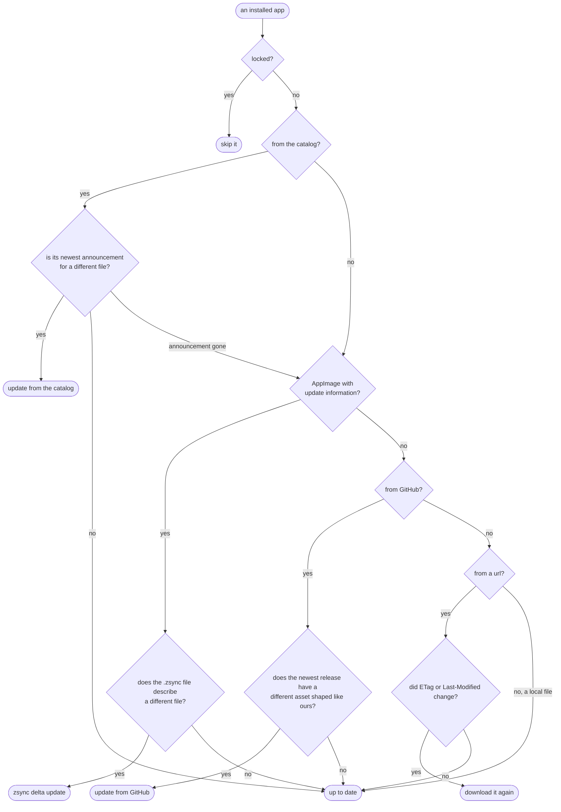
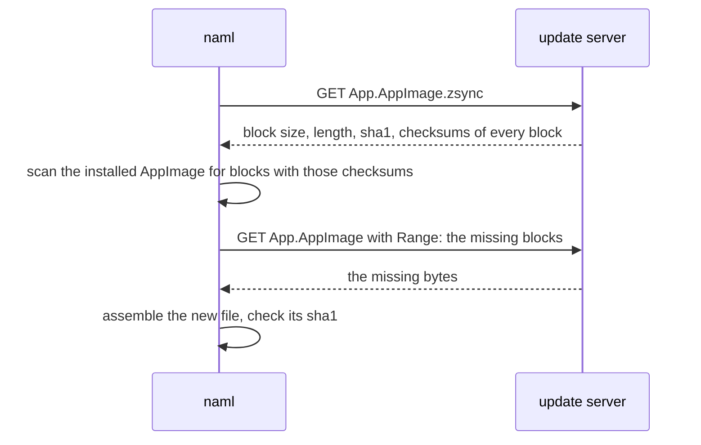
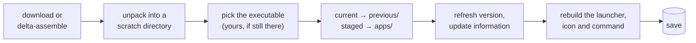
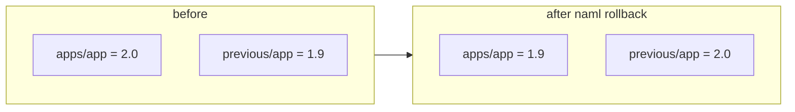

+++
title = "How updates work"
description = "How naml decides an app has an update, downloads it, swaps it in and rolls it back."
weight = 30

[extra]
lead = "Updating is two steps: checking every app for news, then applying the updates you accept."
+++

## Checking

For each app that isn't locked, naml asks the question that fits where the
app came from:

- **Catalog apps** are checked together, with one query to the catalog
  servers per publisher. An announcement only counts if it is at least as new as the one
  the app was installed from.
- **Update information** (`zsync|<url>` or
  `gh-releases-zsync|<owner>|<repo>|<tag>|<pattern>`) points at a `.zsync`
  file; for the GitHub form, naml finds the release by tag (`latest`,
  `latest-pre`, `latest-all` or a fixed tag) and the asset matching the
  pattern. The `.zsync` file holds the new file's sha1, compared with the
  installed one.
- **GitHub apps** find "the same asset" in a new release by its shape: the
  file name with every number blurred, so `App-1.2.0-x86_64.AppImage`
  matches `App-1.3.1-x86_64.AppImage`.
- **Urls** are checked with a `HEAD` request. When the server gives no
  validator, the file is downloaded again, and nothing changes if it has the
  same hash.

## zsync delta updates

A `.zsync` file describes the new version as a list of blocks, each with a
cheap rolling checksum and a strong one. naml slides over the installed
file, finds the blocks it already has, copies those locally, and downloads
only the missing ones with http range requests:

For a typical release only a small part of the file changes. If the delta
fails, or for catalog apps doesn't give the published sha256, naml falls back
to downloading the whole file.

## Applying

The swap is two renames on the same filesystem: the installed directory
becomes the previous version (replacing the one kept before), and the staged
one takes its place. The new version's desktop entry and icon are read again,
and your [launcher edits](@/docs/guide/customizing.md#launchers) are applied
on top.

## Rolling back

A rollback exchanges the two directories (through a temporary name), along
with their versions, hashes and executables, and rebuilds the integration.
Running it again goes forward to the newer version. Locking the app keeps
`naml update` from undoing the rollback.
